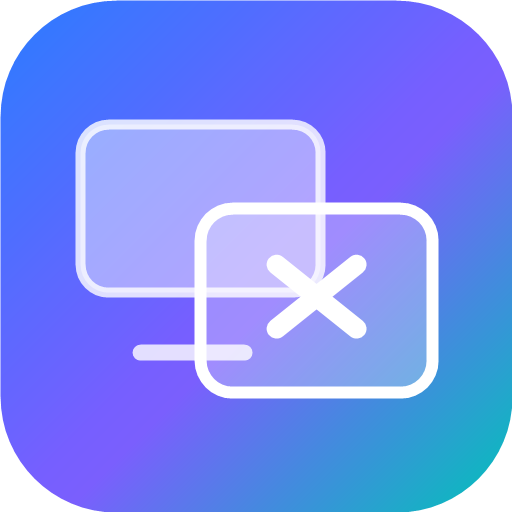

<p align="center">
  
</p>

<h1 align="center">DupliXon</h1>

<p align="center">
  Duplica o extiende la pantalla de tu PC con Windows en tu iPad o iPhone por Wi-Fi,<br>
  <b>sin instalar nada en el dispositivo</b>.
</p>

<p align="center">
  <a href="https://github.com/NixonOchoa/DupliXon/releases/latest/download/DupliXon-Setup.exe">
    
  </a>
</p>

## Instalar

1. **[Descarga DupliXon-Setup.exe](https://github.com/NixonOchoa/DupliXon/releases/latest/download/DupliXon-Setup.exe)**
2. Ábrelo y sigue el asistente. Si Windows SmartScreen avisa, elige *Más información → Ejecutar de todas formas*.
3. ¡Listo! Abre **DupliXon** desde el menú Inicio o el escritorio.

El instalador trae todo lo necesario: no tienes que instalar nada más.

## Usar

1. Abre DupliXon en el PC.
2. En el iPad o iPhone, apunta la cámara al código QR y toca el enlace.
3. Acepta la solicitud en el PC.
4. Opcional: en Safari, *Compartir → Añadir a pantalla de inicio* para tenerlo como app a pantalla completa.

El PC y el dispositivo deben estar en la misma red Wi-Fi, **o conectados por cable USB**.

### Conexión por cable USB (menor latencia)
1. Conecta el iPhone o iPad (con datos móviles) al PC con el cable.
2. En el dispositivo activa **Ajustes → Compartir Internet**.
3. DupliXon lo detecta solo y muestra el distintivo **USB**: escanea el código y listo.

Necesitas la app **Apple Devices** (Microsoft Store) o iTunes en el PC para el controlador USB de Apple.
Los iPad que solo tienen Wi-Fi no pueden compartir conexión por cable: con ellos usa el Wi-Fi.

## Funciones

- 📱 Escaneas un QR, se abre Safari, aceptas la solicitud en el PC y listo.
- ⚡ Fluido a 60 fps con aceleración por hardware (NVIDIA, Intel, AMD).
- 🔍 Resolución adaptada a tu dispositivo, o fija en 1080p / 1440p / **4K**.
- 🔊 El sonido del PC se escucha en el dispositivo.
- 🖥️ **Segunda pantalla**: usa el iPad como un monitor extra.
- 🖱️ **Controla el PC desde el iPad** con toques, trackpad y teclado.
- 🔒 Nada se transmite sin tu aprobación; todo va cifrado y no sale de tu red.

### Control desde el iPad

| Gesto | Acción en el PC |
|---|---|
| Tocar | Clic |
| Mantener pulsado / tocar con dos dedos | Clic derecho |
| Arrastrar con un dedo | Arrastrar (seleccionar, mover ventanas) |
| Deslizar con dos dedos | Desplazar (scroll) |
| Trackpad / ratón del iPad | Puntero, clics y scroll |
| Botón ⌨︎ | Teclado en pantalla |
| Teclado físico | Teclas; ⌘ funciona como Ctrl (⌘C, ⌘V…) |

Toca la barrita superior para mostrar los controles.

### Segunda pantalla

Elige **Segunda pantalla** en DupliXon. La primera vez pulsa **Instalar pantalla virtual** (o marca esa opción en el instalador).
La pantalla extra aparece al conectar el iPad y desaparece al desconectarlo. Ubícala a la izquierda o derecha con **Organizar**.

## Créditos

Creado por **Nixon Ochoa** · njochoa8@gmail.com · [github.com/NixonOchoa](https://github.com/NixonOchoa)

---

<details>
<summary><b>Para desarrolladores</b></summary>

### Requisitos
- Windows 10 21H2+ · [.NET 8 SDK](https://dotnet.microsoft.com/download)
- FFmpeg ≥ 6.1 → `./scripts/install-ffmpeg.ps1`

### Ejecutar desde el código
```powershell
dotnet run --project src/DupliXon.App
```

### Generar el instalador
```powershell
./scripts/build-installer.ps1   # → artifacts/DupliXon-Setup-<versión>.exe
```

### Pruebas
```powershell
dotnet test
```

### Estructura
```
src/
  DupliXon.Core        Modelos, perfiles de resolución, parser H.264 Annex-B
  DupliXon.Media       FFmpeg (captura DXGI + encoder por hardware), audio, entrada, pantalla virtual
  DupliXon.Streaming   Sesiones WebRTC (SIPSorcery)
  DupliXon.Server      Kestrel: receptor web incrustado + señalización WebSocket
  DupliXon.App         App WPF (MVVM, CommunityToolkit) con tema glass
installer/             Script de Inno Setup
tests/                 Pruebas unitarias
docs/                  Arquitectura y ADRs
```
Ver [docs/arquitectura.md](docs/arquitectura.md) y [docs/adr](docs/adr).
</details>
